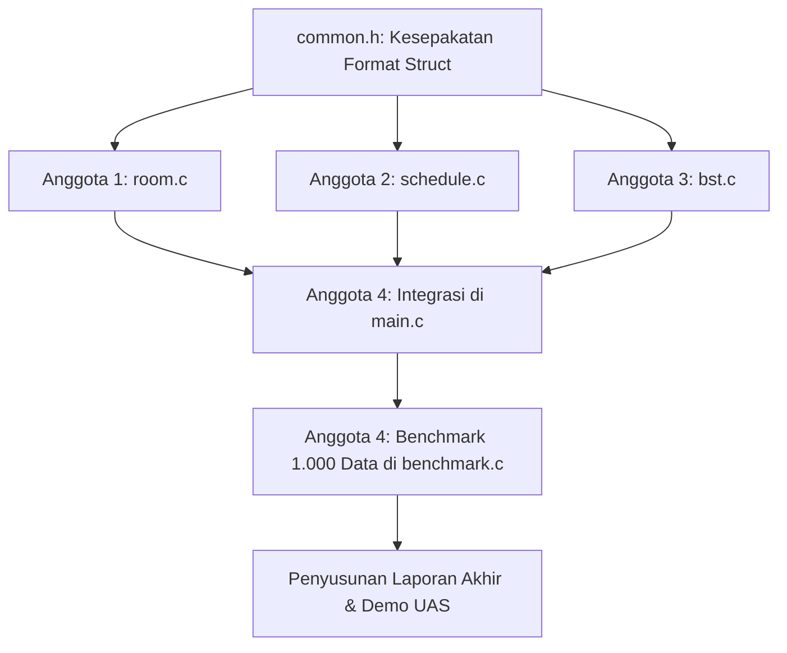

# RENCANA PENGEMBANGAN DAN PEMBAGIAN KERJA PROYEK ROOMFINDER
> **Mata Kuliah:** Struktur Data (Bahasa C)  
> **Status:** Tahap Perancangan Kerangka & Pembagian Modul (Minggu 13)

---

## 1. Status Proyek Saat Ini

Kerangka arsitektur dasar (*skeleton code*) telah berhasil dirancang dan diuji pada alur dasar menu CLI:
1. File header kontrak ADT bersama: [roomfinder.h]
2. Implementasi dasar: [roomfinder.c]
3. Alur menu program utama: [main.c]

Kerangka ini membuktikan bahwa integrasi **Array + Linked List + Binary Search Tree (BST)** dapat saling berkomunikasi tanpa error kompilasi. Selanjutnya, setiap anggota memegang berkas/modul spesifik untuk disempurnakan dan diuji secara mendalam.

---

## 2. Struktur Modul Modular (Rencana Pemisahan Berkas)

Agar setiap anggota dapat bekerja secara mandiri menggunakan Git/file terpisah tanpa konflik (*merge conflict*), kode akan dipisah menjadi 4 modul independen:

```text
Pertemuan 13/
├── common.h          <-- Tipe dasar, konstanta, helper konversi waktu (Kesepakatan Tim)
├── room.h & room.c   <-- [MODUL 1] Dikelola oleh Anggota 1 (Array Ruangan)
├── schedule.h & .c   <-- [MODUL 2] Dikelola oleh Anggota 2 (Linked List Jadwal)
├── bst.h & bst.c     <-- [MODUL 3] Dikelola oleh Anggota 3 (Binary Search Tree)
├── main.c            <-- [MODUL 4] Dikelola oleh Anggota 4 (Menu, Alur & Integrasi)
├── benchmark.c       <-- [MODUL 4] Pengujian kinerja 1.000 data & clock()
└── Proposal_RoomFinder.md
```

---

## 3. Rincian Pekerjaan untuk Setiap Anggota

### 🔹 Anggota 1: Modul Data Ruangan (Array)
**Tanggung Jawab:** Menyimpan master data seluruh ruangan kampus dan menyediakan operasi pengelolaan berbasis Array.
* **Berkas Kerja:** `room.h` dan `room.c`
* **Struktur Data:** `struct Room` dan `struct RoomArray`
* **Daftar Pekerjaan yang Harus Dilakukan:**
  1. [ ] Memastikan alokasi array ruangan aman dari *buffer overflow* (`MAX_ROOMS`).
  2. [ ] Menyempurnakan operasi CRUD Ruangan:
     * `add_room`: Validasi agar kode ruangan unik (tidak duplikat).
     * `update_room`: Mengubah gedung, lantai, kapasitas, atau fasilitas ruangan.
     * `delete_room`: Menggeser elemen array dengan benar saat ada ruangan yang dihapus.
  3. [ ] Menambahkan fitur penyaringan/filter tambahan (misal berdasarkan fasilitas tertentu atau rentang lantai).
  4. [ ] **Dokumentasi Pengujian:** Menyiapkan 3–5 sampel data uji ruangan untuk demonstrasi bab pengujian fungsi.

---

### 🔹 Anggota 2: Modul Jadwal & Logika Anti-Bentrok (Linked List)
**Tanggung Jawab:** Mengelola jadwal penggunaan pada setiap ruangan yang bersifat dinamis serta memvalidasi ketersediaan waktu.
* **Berkas Kerja:** `schedule.h` dan `schedule.c`
* **Struktur Data:** `struct ScheduleNode` (Singly Linked List)
* **Daftar Pekerjaan yang Harus Dilakukan:**
  1. [ ] Menyempurnakan alokasi simpul jadwal dinamis (`malloc` & `free`).
  2. [ ] **Penyisipan Terurut (*Sorted Insert*):** Mengatur agar jadwal yang dimasukkan otomatis tersusun urut berdasarkan jam mulai kegiatan.
  3. [ ] **Logika Anti-Bentrok (*Overlap Checker*):**
     * Memastikan rumus: `(start1 < end2) && (start2 < end1)` berjalan tepat.
     * Menguji kasus batas persis (*boundary case*), misal kegiatan 1 selesai jam 10:00 dan kegiatan 2 mulai jam 10:00 $\rightarrow$ dipastikan **tidak bentrok**.
  4. [ ] Operasi CRUD Jadwal (tambah jadwal baru, hapus jadwal berdasarkan ID, tampilkan daftar jadwal).
  5. [ ] **Dokumentasi Pengujian:** Menyiapkan skenario uji bentrok jadwal untuk laporan.

---

### 🔹 Anggota 3: Modul Indeks Pencarian Kode (Binary Search Tree)
**Tanggung Jawab:** Mengindeks seluruh kode ruangan ke dalam struktur data BST agar pencarian detail ruangan berjalan cepat $\mathcal{O}(\log n)$.
* **Berkas Kerja:** `bst.h` dan `bst.c`
* **Struktur Data:** `struct BSTNode` (Left Child, Right Child, Room Pointer)
* **Daftar Pekerjaan yang Harus Dilakukan:**
  1. [ ] Implementasi algoritma standar BST:
     * `bst_insert`: Menambahkan kode ruangan secara leksikografis/alfabetis (`strcasecmp`).
     * `bst_search`: Mencari ruangan berdasarkan kode secara rekursif/iteratif.
  2. [ ] **Algoritma Penghapusan Node BST (*BST Delete*):**
     * Menangani 3 kasus: node daun (0 anak), node dengan 1 anak, dan node dengan 2 anak (mencari *in-order successor*).
  3. [ ] **Fitur Pembuktian Akademis (Untuk Nilai Tambah di Depan Dosen):**
     * Fungsi *In-Order Traversal* untuk mencetak kode ruangan terurut abjad.
     * Fungsi menghitung tinggi pohon (*tree height*) untuk mengevaluasi keseimbangan pohon.
  4. [ ] **Dokumentasi Pengujian:** Menyiapkan analisis perbandingan kompleksitas teoritis BST $\mathcal{O}(\log n)$ vs Array $\mathcal{O}(n)$.

---

### 🔹 Anggota 4: Integrasi Sistem, Pengujian Kinerja & Memori (Peran Pemula / Lead)
**Tanggung Jawab:** Menghubungkan seluruh modul, memastikan antarmuka konsol berjalan mulus, melakukan uji skala besar (1.000 data), dan memeriksa kebocoran memori.
* **Berkas Kerja:** `main.c`, `benchmark.c`, dan Laporan Proyek
* **Daftar Pekerjaan yang Harus Dilakukan:**
  1. [ ] **Integrasi Menu Utama:** Menggabungkan fungsi dari Anggota 1, 2, dan 3 ke dalam Menu 0–10 di `main.c`.
  2. [ ] **Penanganan Input (*Input Validation*):** Menjamin aplikasi tidak *crash* atau *infinite loop* saat pengguna salah memasukkan tipe data (misal huruf saat diminta angka).
  3. [ ] **Pembuatan Generator Data Uji:**
     * Membuat script/program otomatis untuk menghasilkan minimal **1.000 data** ruangan dan jadwal simulasi (sesuai Bab 9.2 Proposal).
  4. [ ] **Pengujian Kinerja (*Benchmark*):**
     * Mengukur waktu pencarian menggunakan `clock()` dari `<time.h>`.
     * Membandingkan waktu pencarian kode ruangan pada BST vs pencarian sekuensial pada Array dengan 1.000 data.
  5. [ ] **Audit Alokasi Memori:** Memastikan seluruh node `malloc` pada Linked List dan BST dibebaskan dengan fungsi `free()` saat program ditutup.

---

## 4. Alur Kerja Kolaborasi (Workflow)



---

## 5. Perintah Kompilasi

Setiap anggota dapat menguji modulnya secara bersama-sama menggunakan perintah berikut:

```powershell
# Kompilasi seluruh modul menjadi file executable
gcc -Wall -Wextra main.c roomfinder.c -o roomfinder.exe

# Menjalankan program
.\roomfinder.exe
```

*(Setelah berkas dipecah per modul, perintah kompilasi akan menjadi:*  
`gcc -Wall -Wextra main.c room.c schedule.c bst.c -o roomfinder.exe`)
